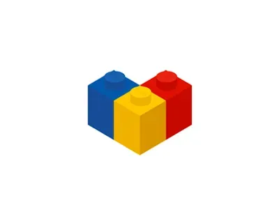

# LegoLogic — App Maker (Prompt → Web App)

<p align="center">
  
</p>

> **"Prompt → Web App Bisnis Siap Pakai dalam Hitungan Menit."**
> Ditenagai oleh model **Claude 3.5 / 3.7 / Sonnet 4.6** via gateway **Sakelar AI**.

---

## 🌟 Tentang LegoLogic

LegoLogic adalah builder web app berbasis prompt yang dirancang khusus untuk pemilik bisnis non-teknis, UMKM, dan agensi di Indonesia. Pengguna cukup mengetikkan kebutuhan dalam Bahasa Indonesia, dan LegoLogic akan merancang arsitektur data, layout visual, logika bisnis, dan langsung menyajikan preview interaktif yang bisa diisi data serta dipublikasikan.

### 🧱 Filosofi Brand
Aplikasi disusun dari balok-balok fungsional (auth, tabel data, alur kanban pipeline, pembayaran, dan halaman publik), selayaknya menyusun balok Lego.

---

## 🚀 Fitur Utama (MVP)

1. **AI Studio Builder (Sakelar AI `claude-sonnet-4.6`)**
   - Mode interaktif: *Build*, *Plan*, dan *Debug*.
   - Transparansi proses berpikir (*Thinking Trace*): analisis token desain, pencarian komponen, pemilihan icon Lucide, dan grid resolution.
   - Progress checklist interaktif (*X/Y done*).
   - Prompt input melayang dengan tombol *Improve Prompt*.

2. **Dual-View Canvas: Preview Interaktif & `<> Code`**
   - **Preview Live:** Render aplikasi secara responsif dengan frame iPhone (375px), Tablet (768px), atau Desktop Full.
   - **CRUD Data Langsung:** Pengguna bisa menambah record, memindahkan kartu di Kanban pipeline, mencari data, dan menghapus baris.
   - **`<> Code` Viewer:** Menampilkan kode sumber TypeScript / React lengkap dengan nomor baris dan tombol salin.

3. **Template Bisnis Awal**
   - **SatuPipeline CRM:** Visual pipeline deal (Rupiah), outreach WhatsApp consent-first, dan log aktivitas.
   - **Karya Agency Portal:** Deliverables milestone, approval review klien, dan status anggaran proyek.
   - **Booking & Katalog Jasa:** Kalender reservasi salon/bengkel dan menu tarif layanan.

4. **Model Harga Per-Aplikasi (Sekali Bayar)**
   - **Minimal (Rp 19.000):** 1 App Aktif, 30 Kredit AI build & revisi, Subdomain .legologic.id, 250 record.
   - **Standar (Rp 49.000) [Paling Populer]:** 1 App Aktif, 100 Kredit AI, Subdomain kustom, 2.500 record, Ekspor CSV & Version Rollback.
   - **Optimal (Rp 99.000) [Rekomendasi]:** 1 App Aktif, 250 Kredit AI Prioritas, Subdomain bebas, Database tak terbatas, Backup otomatis & Kolaborasi tim.

5. **Simulasi Pembayaran Indonesia**
   - QRIS Nasional instan (GoPay, OVO, Dana, ShopeePay, Mobile Banking).
   - Virtual Account otomatis (BCA, Mandiri, BRI, BNI).
   - Hitung mundur pembayaran real-time dan notifikasi aktivasi instan.

6. **Database Terisolasi & Riwayat Versi**
   - Tiap aplikasi memiliki skema tabel terpisah.
   - Ekspor semua data ke CSV dengan 1 klik.
   - Riwayat versi lengkap dengan fitur **1-Click Rollback** untuk mengembalikan versi sebelumnya tanpa kehilangan histori.

---

## 🛠️ Tech Stack

- **Framework:** Next.js 16 (App Router) + React 19 + TypeScript
- **Styling:** Tailwind CSS v4 + Lucide Icons + Canvas Confetti
- **AI Gateway:** Sakelar AI (`claude-sonnet-4.6`)
- **Deployment:** Vercel / Node.js Standalone

---

## 💻 Menjalankan Secara Lokal

1. **Clone repository:**
   ```bash
   git clone https://github.com/ibobatsuga/legologic.git
   cd legologic
   ```

2. **Install dependensi:**
   ```bash
   npm install
   ```

3. **Konfigurasi Environment:**
   Salin `.env.example` ke `.env.local` dan isi API key Sakelar AI:
   ```bash
   cp .env.example .env.local
   ```

4. **Jalankan development server:**
   ```bash
   npm run dev
   ```
   Buka [http://localhost:3000](http://localhost:3000) di browser.

5. **Build untuk production:**
   ```bash
   npm run build
   npm start
   ```

---

## 📄 Lisensi
Hak Cipta © 2026 LegoLogic. Seluruh hak cipta dilindungi undang-undang.
